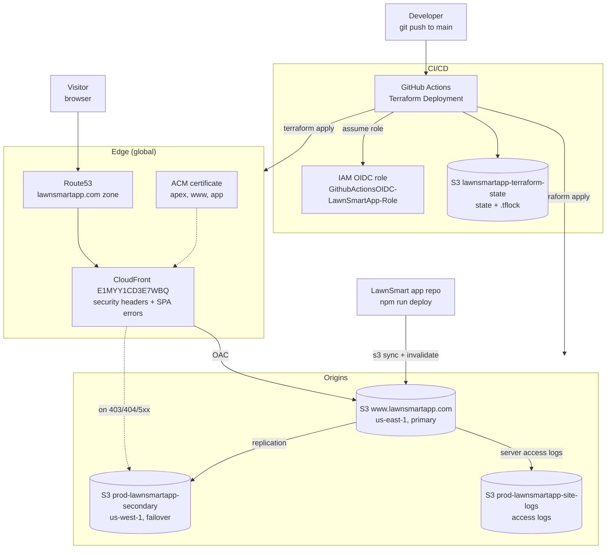
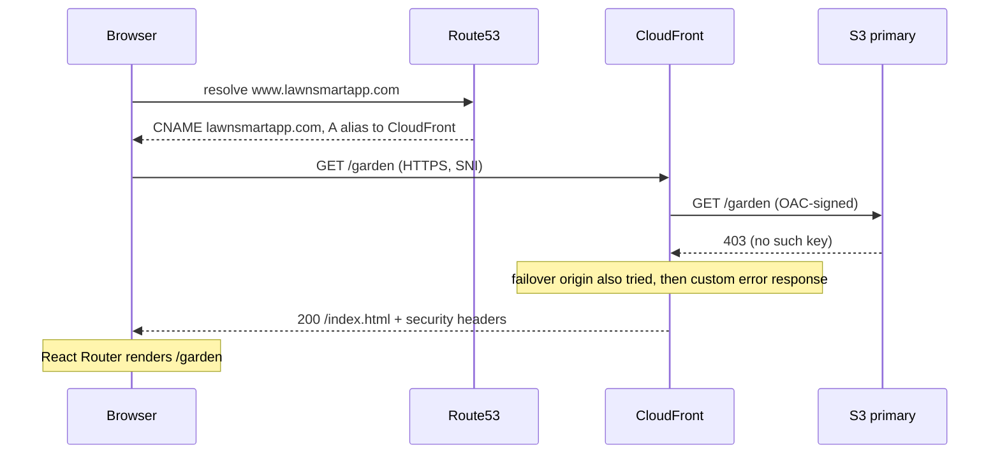
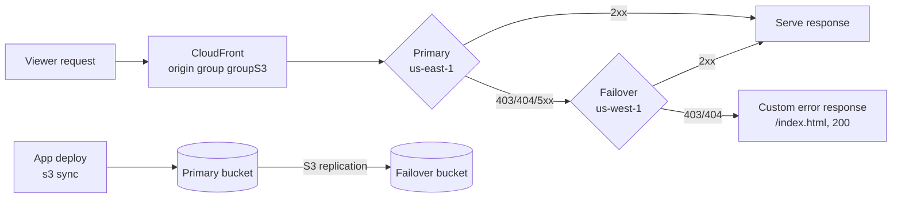
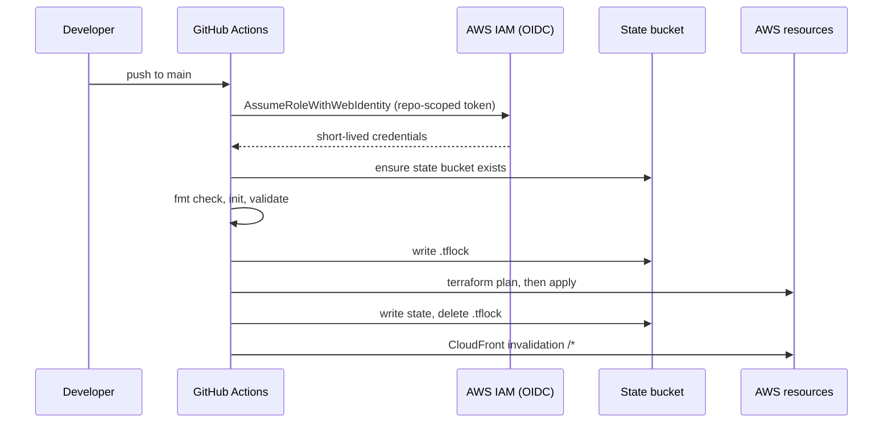

# AWS Hosting for LawnSmart App

[](https://lawnsmartapp.com)
[](https://github.com/jxman/aws-hosting-lawnsmartapp/actions/workflows/terraform.yml)


Terraform infrastructure that hosts the LawnSmart React app on AWS, deployed only through GitHub Actions with OIDC.

**What it does**

- **Serves the app on three hostnames**: `lawnsmartapp.com`, `www.lawnsmartapp.com` and `app.lawnsmartapp.com` all reach one CloudFront distribution with a single ACM certificate.
- **Fails over across regions**: the site bucket in us-east-1 replicates to us-west-1, and CloudFront switches origins automatically when the primary returns errors.
- **Sends security headers on every response**: CSP, HSTS with preload, `X-Frame-Options: DENY` and others, from one CloudFront response headers policy.
- **Supports React SPA routing**: 403 and 404 responses return `index.html`, so client-side routes work on reload.
- **Deploys through CI only**: GitHub Actions authenticates with OIDC (no stored AWS keys) and applies on every push to `main`.

## Contents

- [Architecture](#architecture)
- [Tech stack](#tech-stack)
- [Request serving and DNS](#request-serving-and-dns)
- [Origin failover and replication](#origin-failover-and-replication)
- [Security headers](#security-headers)
- [CI/CD pipeline](#cicd-pipeline)
- [Terraform state and locking](#terraform-state-and-locking)
- [Resource tagging](#resource-tagging)
- [Infrastructure and configuration](#infrastructure-and-configuration)
- [Project structure](#project-structure)
- [Local development](#local-development)
- [Deployment](#deployment)
- [Observability](#observability)
- [Known constraints](#known-constraints)
- [Roadmap](#roadmap)

---

## Architecture

### System overview

Visitors reach CloudFront through Route53. CloudFront reads the static build
from S3 through Origin Access Control, failing over to a replica bucket in a
second region. Terraform in GitHub Actions manages all of it, and the app
itself is built and uploaded from the separate
[LawnSmart](https://github.com/jxman/LawnSmart) repository.



Each part is covered in its own section below.

### Terraform modules

| Module | Resources | Purpose |
|---|---|---|
| `modules/s3-website` | 3 S3 buckets, replication role and policy, lifecycle, logging | Primary site bucket, us-west-1 failover replica, access-logs bucket |
| `modules/cloudfront` | Distribution, OAC, response headers policy | CDN with origin group failover, SPA error handling, security headers |
| `modules/acm-certificate` | Certificate, DNS validation records | TLS for the apex, `www` and `app` |
| `modules/route53` | A alias (apex), A alias (`app`), weighted CNAME (`www`) | DNS into CloudFront |
| `main.tf` | Bucket policies for both site buckets | Grant CloudFront read access, scoped to the distribution ARN |

The OIDC provider, role and policy are deliberately **not** in Terraform. They
are managed by `scripts/bootstrap-oidc.sh` (see [CI/CD pipeline](#cicd-pipeline)).

## Tech stack

| Layer | Technology |
|---|---|
| Infrastructure as code | Terraform 1.15 (`>= 1.10` required), AWS provider `~> 5.30` |
| CDN | Amazon CloudFront (PriceClass_200, HTTP/2 and HTTP/3, TLS 1.2+) |
| Storage | Amazon S3 with cross-region replication, Intelligent-Tiering, versioning |
| DNS and TLS | Amazon Route53, AWS Certificate Manager |
| CI/CD | GitHub Actions with AWS IAM OIDC federation |
| State | S3 backend with S3 lockfile locking (`use_lockfile`) |
| App (separate repo) | React (Create React App), deployed with `aws s3 sync` |

## Request serving and DNS

- The apex `lawnsmartapp.com` and `app.lawnsmartapp.com` are Route53 **A alias**
  records pointing at the CloudFront distribution.
- `www.lawnsmartapp.com` is a **weighted CNAME** (`set_identifier = "live"`,
  weight 90, TTL 5s) pointing at the apex. It serves the same content; it is
  not a redirect.
- One ACM certificate covers all three names. It is DNS-validated through
  records Terraform writes into the same zone, with `create_before_destroy`
  so adding a name swaps certificates without downtime.
- CloudFront redirects HTTP to HTTPS, caches with the AWS managed
  `CachingOptimized` policy and compresses responses.
- `default_root_object` is `index.html`, and 403 or 404 from the origin
  returns `/index.html` with status 200, so React Router deep links work.



## Origin failover and replication

- The site bucket `www.lawnsmartapp.com` (us-east-1) is versioned, encrypted
  (AES256) and replicates every object to `prod-lawnsmartapp-secondary`
  (us-west-1) through a dedicated IAM role.
- CloudFront uses an **origin group**: requests go to the primary, and are
  retried against the failover bucket when the primary returns
  403, 404, 500, 502, 503 or 504.
- Both buckets block all public access. Their bucket policies (in `main.tf`)
  allow only the CloudFront service principal, conditioned on this
  distribution's ARN.
- The primary bucket uses Intelligent-Tiering (archive after 125 days, deep
  archive after 180) and writes server access logs to
  `prod-lawnsmartapp-site-logs`, which moves logs to One Zone-IA after 30 days
  and deletes them after 90.



## Security headers

One response headers policy (`prod-security-headers-lawnsmartapp-com`) is
attached to the default behavior and overrides any origin headers:

| Header | Value |
|---|---|
| `Content-Security-Policy` | `default-src 'self'`; scripts from Google Tag Manager (with `'unsafe-inline'` and `'unsafe-eval'`); styles and fonts from Google Fonts; images from `m.media-amazon.com`; connections to Google Analytics |
| `Strict-Transport-Security` | `max-age=31536000; includeSubDomains; preload` |
| `X-Frame-Options` | `DENY` |
| `X-Content-Type-Options` | `nosniff` |
| `X-XSS-Protection` | `1; mode=block` |
| `Referrer-Policy` | `strict-origin-when-cross-origin` |

The full CSP string is in `modules/cloudfront/main.tf`. When the app adds a new
third-party origin (fonts, analytics, images), add it to the CSP here, or the
browser blocks it. Check the result with:

```bash
curl -sI https://lawnsmartapp.com | grep -iE "content-security|strict-transport|x-frame"
```

## CI/CD pipeline

All infrastructure changes deploy through the **Terraform Deployment**
workflow (`.github/workflows/terraform.yml`). Local `terraform apply` is not
used; the old local scripts are kept only for reference in
[`archived/`](archived/README.md).

| Trigger | What runs |
|---|---|
| Push to `main` touching `**.tf` or the workflow | Plan, then **apply** |
| Pull request to `main` | Plan only; posts the plan as a PR comment and uploads it as an artifact |
| Manual, `action=plan` (the default) | Plan only |
| Manual, `action=apply` | Plan, then **apply** |



**OIDC authentication.** The workflow assumes
`GithubActionsOIDC-LawnSmartApp-Role`, whose trust policy only accepts tokens
from `jxman/aws-hosting-lawnsmartapp`. The role, its policy
`GithubActions-LawnSmartApp-Policy` and the
`token.actions.githubusercontent.com` provider are created and updated by:

```bash
bash scripts/bootstrap-oidc.sh   # idempotent; creates or updates tags and policy
```

When you change the role's permissions, update the live policy **and**
`scripts/bootstrap-oidc.sh` in the same commit. Why OIDC lives outside
Terraform is explained in the
[changelog](CHANGELOG.md#oidc-terraform-module-to-bootstrap-script).

## Terraform state and locking

| Environment | State bucket | State key | Used by |
|---|---|---|---|
| prod | `lawnsmartapp-terraform-state` | `lawnsmartapp-com/terraform.tfstate` | CI |
| dev | `lawnsmartapp-terraform-state-dev` | `terraform.tfstate` | Manual only |
| staging | `lawnsmartapp-terraform-state-staging` | `terraform.tfstate` | Manual only (bucket not created) |

- Every backend sets `encrypt = true` and `use_lockfile = true`. Terraform
  writes `<key>.tflock` next to the state file while a plan or apply runs, so
  no DynamoDB table is involved.
- Don't run a local plan while CI is running; the two contend for the same
  lock.
- A stale lock left by a crashed run can be released with
  `terraform force-unlock <LOCK_ID>` after checking
  `aws s3 ls s3://lawnsmartapp-terraform-state/lawnsmartapp-com/`.
- `scripts/create-prerequisites.sh` creates tagged, versioned, encrypted state
  buckets for all three environments.

## Resource tagging

Every resource carries the 10 standard tags. Terraform applies the first eight
through the provider's `default_tags` (`local.common_tags` in `variables.tf`);
each resource adds its own `Name` and `SubService`.

| Tag | Value |
|---|---|
| `Environment` | `prod`, `staging` or `dev` |
| `ManagedBy` | `terraform`, or `bootstrap-script` for OIDC resources and state buckets |
| `Owner` | `John Xanthopoulos` |
| `Project` | `lawnsmartapp` |
| `Service` | `lawnsmartapp-website` |
| `GithubRepo` | `github.com/jxman/aws-hosting-lawnsmartapp` |
| `Site` | Site domain, e.g. `lawnsmartapp.com` |
| `BaseProject` | `lawnsmartapp.com` |
| `Name` | Resource-specific |
| `SubService` | Component, see below |

| Resource | `SubService` | `ManagedBy` |
|---|---|---|
| S3 primary bucket | `primary-website-bucket` | terraform |
| S3 failover bucket | `failover-website-bucket` | terraform |
| S3 logs bucket | `access-logs-bucket` | terraform |
| CloudFront distribution | `cdn-distribution` | terraform |
| ACM certificate | `ssl-certificate` | terraform |
| Replication role / policy | `s3-replication-role` / `s3-replication-policy` | terraform |
| OIDC provider | `github-oidc-provider` | bootstrap-script |
| GitHub Actions role / policy | `github-actions-role` / `github-actions-policy` | bootstrap-script |
| Terraform state buckets | `terraform-state-bucket` | bootstrap-script |

Prod resources also carry `awsApplication`, which places them in the
**LawnSmartApp** application in AWS myApplications. It is set from
`aws_application_arn` in `environments/prod/terraform.tfvars`; leaving it empty
omits the tag.

```bash
# Find everything in this project
aws resourcegroupstaggingapi get-resources --tag-filters Key=Project,Values=lawnsmartapp
```

## Infrastructure and configuration

### Production resources

| Resource | Identifier |
|---|---|
| CloudFront distribution | `E1MYY1CD3E7WBQ` (`d1yvxqir7ibuig.cloudfront.net`) |
| ACM certificate | `arn:aws:acm:us-east-1:600424110307:certificate/081bc4fc-8e84-4e23-886a-6347bc041d6c` |
| Route53 hosted zone | `Z04860973DG1BJ5J1VVBE` (`lawnsmartapp.com`) |
| S3 primary | `www.lawnsmartapp.com` (us-east-1) |
| S3 failover | `prod-lawnsmartapp-secondary` (us-west-1) |
| S3 access logs | `prod-lawnsmartapp-site-logs` |
| Replication role | `prod-lawnsmartapp-replication-role` |
| GitHub Actions role | `GithubActionsOIDC-LawnSmartApp-Role` |

### Terraform variables

| Variable | Default | Prod value | Purpose |
|---|---|---|---|
| `base_domain` | `lawnsmartapp.com` | same | Hosted zone and certificate domain |
| `environment` | `prod` | `prod` | Prefix for resource names; non-prod sites use `<env>.<base_domain>` |
| `site_name` | `""` | unset | Overrides the computed site domain |
| `primary_region` | `us-east-1` | same | Primary bucket region |
| `secondary_region` | `us-west-1` | same | Failover bucket region |
| `github_repository` | `jxman/aws-hosting-lawnsmartapp` | same | Used in tags |
| `aws_application_arn` | `""` | LawnSmartApp group ARN | Adds the `awsApplication` tag when set |

Values per environment live in `environments/<env>/terraform.tfvars`, and the
backend in `environments/<env>/backend.conf`.

### Outputs

`terraform output` returns `website_url`, `cloudfront_distribution_id`,
`cloudfront_domain_name`, `certificate_arn`, `primary_s3_bucket` and
`failover_s3_bucket`. CI prints them after each apply.

## Project structure

```text
aws-hosting-lawnsmartapp/
├── .github/workflows/
│   ├── terraform.yml          # Terraform Deployment workflow
│   └── README.md              # Workflow reference
├── modules/
│   ├── acm-certificate/       # Certificate + DNS validation
│   ├── cloudfront/            # Distribution, OAC, security headers
│   ├── route53/               # Apex, app and www records
│   └── s3-website/            # Site, failover and logs buckets, replication
├── environments/
│   ├── prod/                  # backend.conf + terraform.tfvars (used by CI)
│   ├── dev/                   # Manual use only
│   ├── staging/               # Manual use only; state bucket not created
│   └── README.md
├── scripts/
│   ├── bootstrap-oidc.sh      # Creates/updates the OIDC provider, role, policy
│   ├── create-prerequisites.sh# Creates tagged state buckets
│   ├── generate-architecture-diagram.sh, claude-automation.sh,
│   │   asset-manager.sh, claude-prompts/   # SVG diagram tooling
│   └── README.md
├── docs/
│   ├── deployment-guide.md    # Day-to-day deployment and troubleshooting
│   ├── oidc-bootstrap-migration.md # Runbook: OIDC out of Terraform (done)
│   └── app-subdomain-migration.md  # app.lawnsmartapp.com phase 1 (done)
├── archived/                  # Deprecated local deploy scripts, old OIDC module
├── main.tf                    # Module wiring + CloudFront bucket policies
├── variables.tf               # Variables, locals, common tags
├── outputs.tf
├── provider.tf                # us-east-1 and us-west-1 providers
├── versions.tf                # Terraform and provider versions, S3 backend
├── CHANGELOG.md
└── CLAUDE.md                  # Project rules for Claude Code
```

## Local development

Prerequisites: Terraform 1.15 (`>= 1.10`), the GitHub CLI, and the AWS CLI
with read access to the account for plans.

```bash
git clone https://github.com/jxman/aws-hosting-lawnsmartapp.git
cd aws-hosting-lawnsmartapp

terraform fmt -recursive
terraform init -backend-config=environments/prod/backend.conf -reconfigure
terraform validate
terraform plan -var-file=environments/prod/terraform.tfvars   # read-only preview
```

Local work stops at `plan`. Applies happen in CI.

## Deployment

**Infrastructure** deploys when a change to `**.tf` or the workflow is pushed
to `main`. To apply without a code change, run the workflow manually with
`action=apply`:

```bash
gh workflow run "Terraform Deployment" --ref main -f action=apply   # plan + apply
gh workflow run "Terraform Deployment" --ref main                   # plan only
gh run list --workflow terraform.yml --limit 5
gh run watch <RUN_ID>
```

The plan step uses `continue-on-error`, so a green run does not prove the
apply happened. Check the log for `Apply complete!`. After every apply, the
workflow invalidates `/*` on the distribution.

**App content** deploys from the [LawnSmart](https://github.com/jxman/LawnSmart)
repo with `npm run deploy`, which builds, syncs `build/` to
`s3://www.lawnsmartapp.com/` with `--delete`, and invalidates CloudFront.

**Rollback**: revert the commit on `main` and push, or re-run an earlier
successful workflow run with `gh run rerun <RUN_ID>`.

**Verify**:

```bash
for h in lawnsmartapp.com www.lawnsmartapp.com app.lawnsmartapp.com; do
  curl -sI "https://$h" | head -1
done
```

More detail and troubleshooting are in
[docs/deployment-guide.md](docs/deployment-guide.md).

## Observability

| Source | Where | Retention |
|---|---|---|
| Deployment history | [GitHub Actions runs](https://github.com/jxman/aws-hosting-lawnsmartapp/actions) | GitHub default |
| S3 server access logs (primary bucket) | `s3://prod-lawnsmartapp-site-logs/www.lawnsmartapp.com/` | 90 days |
| CloudFront metrics | CloudFront console, distribution `E1MYY1CD3E7WBQ` | AWS default |
| API activity | CloudTrail (account-level) | Account setting |
| Application view | AWS myApplications, LawnSmartApp | n/a |

There are no CloudWatch dashboards or alarms, and CloudFront access logging is
not enabled (see [Known constraints](#known-constraints)).

## Known constraints

- **No monitoring or alarms.** The project rules call for CloudWatch dashboards
  and alarms (error rate > 5%, cache hit < 80%, latency > 1000 ms); none exist
  yet.
- **Intelligent-Tiering archives rarely read site files.** The primary bucket's
  configuration moves objects unread for 125 days to Archive Access (180 to
  Deep Archive). S3 cannot serve archived objects without a restore, so
  CloudFront gets an error and falls back to the us-west-1 replica, which
  stays in Standard. The site keeps working, but only because of failover.
- **SPA deep links trigger failover.** A route like `/garden` is a 403 from the
  primary bucket, which matches the origin group's failover criteria, so
  CloudFront also requests it from us-west-1 before returning `index.html`.
- **CI is prod-only.** The dev and staging configs exist for manual plans, and
  staging's state bucket has never been created.
- **The OIDC policy is broad.** Only its IAM and DynamoDB statements are
  scoped to project ARNs; `s3:*`, `cloudfront:*`, `route53:*`, `acm:*`,
  `cloudwatch:*` and `logs:*` apply to all resources in the account.
- **Diagram tooling predates the Mermaid standard.** The scripts in `scripts/`
  generate SVG diagrams with AWS icons; the README diagrams are Mermaid.

## Roadmap

Shipped work is listed in [CHANGELOG.md](CHANGELOG.md).

- [ ] Remove the DynamoDB lock tables and their IAM permissions after the S3 lockfile has run cleanly ([#2](https://github.com/jxman/aws-hosting-lawnsmartapp/issues/2), not before 2026-11-06)
- [ ] App subdomain phase 2: migration banner on `www` that moves users' localStorage to `app` (app repo)
- [ ] App subdomain phase 3: serve a marketing landing page from `www`
- [ ] Remove the archive tiers from the primary bucket's Intelligent-Tiering configuration
- [ ] CloudWatch dashboard and alarms for 5xx rate, cache hit ratio and origin latency
- [ ] Scope the OIDC policy's S3, CloudFront, Route53 and ACM permissions to this project's resources
- [ ] Pre-commit hooks (`terraform fmt`, conflict markers, gitleaks, Conventional Commits)

---

_Maintained by John Xanthopoulos_
